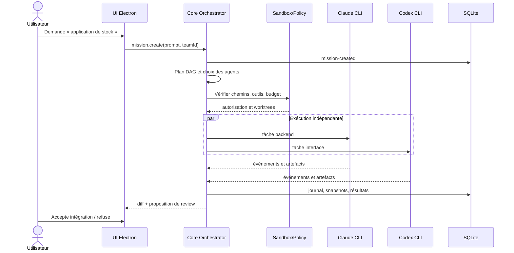
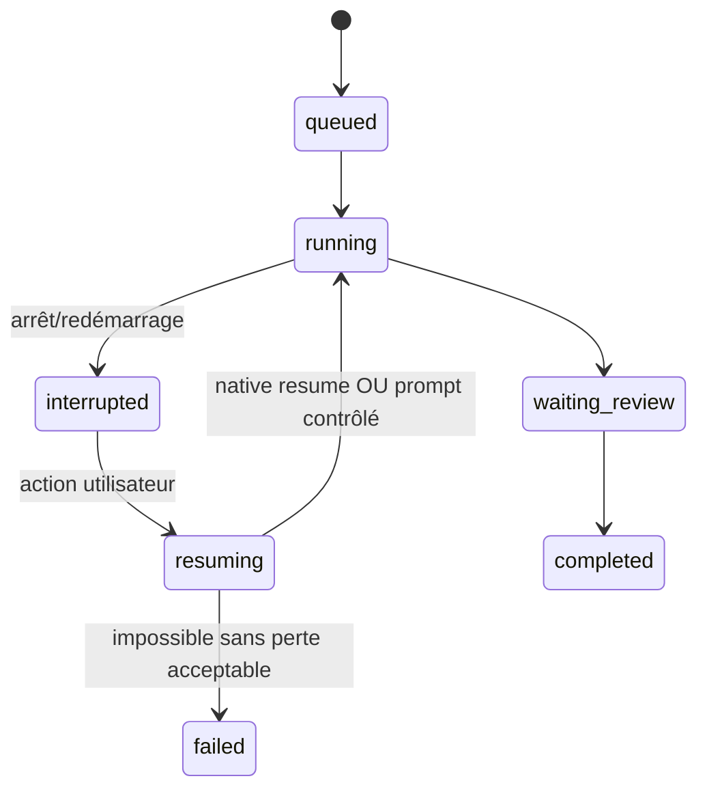

# Exemples de séquences et responsabilités

> Nexus AI — spécification d'origine (version documentaire 1.1, 10 octobre 2026). Document de conception, conservé pour référence : l'état réel est décrit dans `docs/ARCHITECTURE.md`, `docs/USER_GUIDE.md` et `.coordination/STATUS.md` ; en cas d'écart, le code fait foi.

## Mission automatique

## Reprise après arrêt

## Exemple de politique de fichiers
Projet repo isolé : `/workspace/<task-id>` en lecture-écriture ; montage de contrats explicitement autorisés ; `~/.ssh`, `.aws`, `.config` et `.env` non montés ; connecteurs spécialisés utilisent leurs credentials dans un processus broker indépendant du CLI agent. Les chemins exacts diffèrent selon OS.
